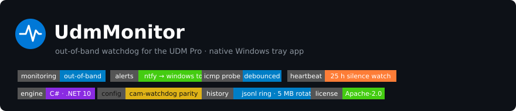
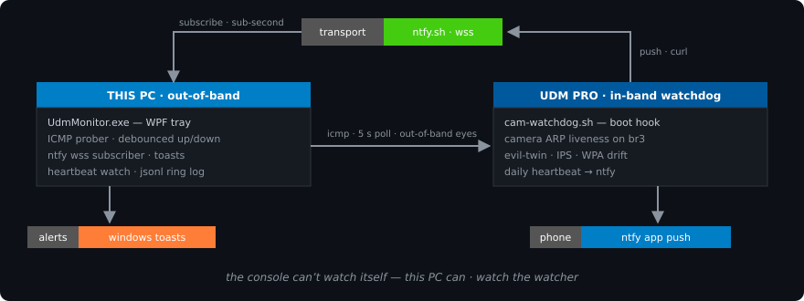

<p align="center"></p>

<h1 align="center">UdmMonitor</h1>

<p align="center">
  <a href="https://github.com/dparksports/udm-monitor/actions/workflows/build.yml"></a>
  <a href="https://github.com/dparksports/udm-monitor/releases"></a>
  <a href="LICENSE"></a>
  
  
  
</p>

Out-of-band, real-time monitoring for a **UDM Pro** network from a Windows PC — a native
tray app plus the on-box watchdog scripts it watches. The UniFi web console runs *on*
the gateway it monitors, so when the UDM itself dies, the console goes dark and tells
you nothing. This project puts a second pair of eyes on a separate machine.

<p align="center"></p>

## How it works

| Layer | Where | What it catches |
|---|---|---|
| `watchdog/cam-watchdog.sh` | UDM Pro (on-box, boot hook) | Camera ARP-liveness per bridge, evil-twin APs, IPS/threat events, WPA3 drift — pushed to ntfy |
| `app/` — UdmMonitor tray app | This PC (out-of-band) | UDM unreachable, WAN-down/LAN-up, internet loss, watchdog heartbeat silence; relays every on-box alert as a Windows toast |

The two layers meet at an ntfy topic: the on-box script pushes, the Windows app
subscribes over WebSocket, and everything lands in one dashboard with durable
`events.jsonl` history. Neither layer can blind the other.

## Quick start

```powershell
# build & run the tray app (needs .NET 10 SDK)
dotnet run --project app/src/UdmMonitor.App/UdmMonitor.App.csproj

# 20 s headless verification run
dotnet run --project app/src/UdmMonitor.App/UdmMonitor.App.csproj -- --smoke
```

Or grab the self-contained `UdmMonitor-win-x64.zip` from
[releases](https://github.com/dparksports/udm-monitor/releases) — no .NET install needed.

`udmmonitor.json` is created beside the exe on first run; thresholds default to the
same semantics as `watchdog/cam-watchdog.conf` (3 misses = down, 10-min re-alert,
25-h heartbeat timeout). Full details in [app/README.md](app/README.md).

## Deploying the on-box watchdog

```sh
# on the UDM Pro (ubios with the udapi on-boot plugin):
cp watchdog/cam-watchdog.sh watchdog/cam-watchdog.conf /data/scripts/
cp watchdog/99-cam-watchdog.sh /data/scripts/   # starts it on boot
sh /data/scripts/cam-watchdog.sh                # start now
```

Edit `/data/scripts/cam-watchdog.conf` for your cameras, SSIDs, and ntfy topic.

## Repo layout

- `app/src/UdmMonitor.Core` — UI-free engine: event bus, ICMP prober, ntfy subscriber, heartbeat watch, JSONL log
- `app/src/UdmMonitor.App` — WPF shell: tray, toasts, dashboard
- `watchdog/` — on-box scripts for the UDM Pro itself
- `logs/netmon.ps1` — legacy ad-hoc NIC/gateway poller (superseded by the app)
- `docs/` — banners and infographics

## Security notes

This is a **private** repo and it should stay one: the watchdog conf and app config
contain SSIDs, internal IPs, and the ntfy topic (which is the only secret protecting
the alert stream on a public ntfy.sh — keep it unguessable, or self-host ntfy).

## License

[Apache-2.0](LICENSE) © Dan Park
